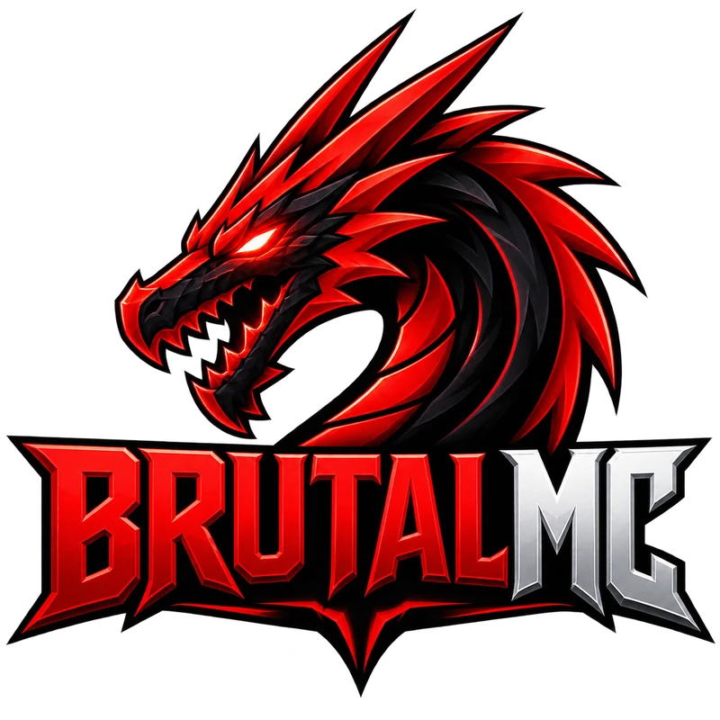

<p align="center"></p>

# BrutalMC Website

The official website for **BrutalMC**, a custom world survival SMP Minecraft server in Bangladesh.

**Live site:** https://www.brutalmc.xyz · **Server IP:** `play.brutalmc.xyz` (Bedrock port `19132`)

## Pages
- **Home** – live server status, game portals, rank pricing
- **Dragons** – Shenron 3D model, dragon abilities and loot
- **Survival SMP** – custom world features and progression
- **Leaderboards** – top players
- **Ranks** – Elite, King, Hero, Legend and Brutal perks
- **Store** – bKash / Nagad checkout that hands the order to staff on Discord
- **Events** – weekly events with live countdowns (Bangladesh time)
- **Staff**, **Community**, **FAQ**

## Built with
Next.js (static export) · React · TypeScript · Tailwind CSS · Three.js · Lenis

## Editing common settings
Server IP, Discord invite, social links and the bKash / Nagad numbers all live in
[`src/lib/site.ts`](src/lib/site.ts). Change them there and they update across the site.

## Run locally
```bash
npm install
npm run dev      # http://localhost:3000
npm run build    # static site in ./out
```

## Deploying
Every push to `main` builds the site and publishes it to GitHub Pages
(`.github/workflows/deploy.yml`). The custom domain is set by `public/CNAME`.

## Credits
Made by [Tecnolegend](https://github.com/Tecnolegend) ·
[YouTube](https://www.youtube.com/@tecnolegendmc) ·
[Instagram](https://www.instagram.com/tecnolegend103/) ·
Discord: `tecnolegend103`

Not an official Minecraft product. Not approved by or associated with Mojang or Microsoft.
